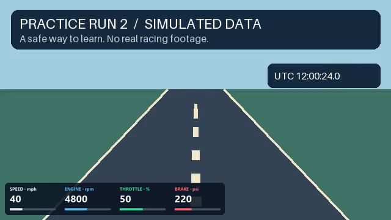

# GoPro VBOX Sync

**Free Windows software for pairing GoPro video with VBOX telemetry.**

[**Download for Windows →**](https://github.com/wgm20/gopro-vbox-sync/releases/download/v1.6.0b13/GoPro-VBOX-Sync-1.6.0b13-Setup.exe)

**Version 1.6.0b13 · Released 30 October 2026.** No Python installation, payment, activation or GitHub account is needed. Visit the [download page](https://wgm20.github.io/gopro-vbox-sync/) for an overview. A portable ZIP is also available on the [releases page](https://github.com/wgm20/gopro-vbox-sync/releases/tag/v1.6.0b13): extract the entire folder before opening GoProVBOXSync.exe.

> **Beta: Circuit Tools 3 compatibility is unresolved.** Circuit Tools can reject generated VBO files with an authenticity/checksum error and may close. Re-encoding is not a proven fix. A successful export does not guarantee Circuit Tools acceptance. Test a short run first.



## Get started

Scan and compare recordings before starting a conversion.

1. Install and open GoPro VBOX Sync. The app offers a verified download of FFmpeg video tools if needed (110 MB; allow 500 MB free space). Processing works offline after setup.
2. Under **Choose recording folders**, choose the folder containing your **VBOX runs**. **GoPro videos** starts with that folder automatically. For GoPro files elsewhere, browse for an SD card, its `DCIM` folder or any other folder, or type its path. The app remembers a separate GoPro folder; clear the field to use the VBOX folder again. GoPro subfolders are searched by default, including the card's camera folders; change this under **Options → Include GoPro subfolders**, and the app remembers your choice. Check both folder paths, then click **Scan for matches** beneath them to find runs before choosing videos to convert. No copying is needed.
3. Compare **Date**, **Start** and **Best in file** before ticking the videos to **Include**. Dates and start times come from GoPro GPS timestamps; choose local time or UTC and click column headings to sort. **Best in file** is the fastest complete VBOX lap wholly within that GoPro file's GPS time range; **—** means none. A separate red star (**★**) marks footage from the whole-run fastest lap. Include all marked files if it spans chapters. **Options → Details…** shows the whole-run best and explains split laps. **Options → What do red stars mean?** explains the markers. Click each row to inspect its preview. Rotation defaults to **Upright — no rotation**; change it when needed. Keep the original VBOX MP4/AVI files beside the VBO files to enable cropping.
4. Use **Options** beside **Help** to choose **Resolution**, **Overlay** and **Sound**, then open **Frame & preview…**. Tick **Crop to VBOX**, drag the crop box on the left and check the finished picture on the right. Arrow keys allow fine adjustments. Click **Apply**, then **Create files**. Each video has its own framing. **Options → Only export video with VBOX data** starts ticked; untick it to keep full videos. The app remembers that choice.
5. The output location defaults to a new folder under your VBOX folder, so you can read GoPro clips directly from the card. Keep the card connected until processing finishes. The finished folder contains only MP4 and VBO files; keep them together. The MP4 also plays in ordinary video players. Use the app's **Report** button for the export summary.

**Start with Help → Try practice recordings.** Two short synthetic movies and matching data are included. Try unticking one run and exporting the other. The illustrated **Help → Quick-start guide** works offline and covers setup, overlays, troubleshooting and privacy.

## What it does

- Matches by GoPro GPS timestamps, checks concurrent position and speed, and handles partial overlaps, gaps, midnight and consecutive camera chapters.
- The desktop app scans GoPro footage in a separate folder or SD card and searches its subfolders by default. VBOX runs stay in their own folder with their original VBOX videos for sound and cropping. Source recordings are read without copying or changing them.
- Shows recording dates, start times and the fastest complete lap within each GoPro file during scanning, before video conversion. Sortable headings help compare files; a separate red star marks footage of the whole-run fastest lap. **Options → Details…** identifies the run, lap and camera coverage.
- Exports only matching periods by default, with separate clips for gaps and adjusted VBOX playback times. Sound, overlays and GPS clock drift stay aligned. The frames containing the boundary samples are retained; full-session lap history remains available. Untick **Options → Only export video with VBOX data**, or pass `--full-video`, to keep full videos.
- Defaults the desktop app to no rotation and gives you a preview to check. Manual rotation is available; detected orientation remains in scan details.
- Lets you drag a crop over the full source image while previewing the finished picture and gauges. Cropping retains the linked VBOX video’s display aspect ratio, normally 16:9. Rotation is applied first and overlays are fitted afterwards. Missing or conflicting original VBOX videos disable cropping for that recording; uncropped output remains available. The command line retains its top, bottom and centre presets.
- Exports only the videos you tick and links only overlapping VBOX samples.
- Uses original VBOX sound by default, aligned using the VBO video references and GoPro GPS timestamps. Keep the original VBOX MP4 files beside the VBO files. **Options → Sound → GoPro** retains the GoPro recording; the app remembers your choice. Missing or unreliable VBOX sound falls back to GoPro sound, with the affected periods listed in the report.
- Adds speed, RPM, throttle and brake with a built-in dashboard or a supported scene.
- Renders a supported full scene, excluding the rear camera, with proportional gauges and an undistorted track map.
- Imports new `.VVHSN` scene files through the public scene importer in a compatible installation of VBOX Video Setup. A previously imported copy is not required.
- Opens reusable `.gvscene` saved scene packages locally, including artwork and fonts from a previous scene import, without the VBOX Video Setup library.
- Preserves source recordings. New outputs are published only after validation; changed settings require a fresh output folder.

Open **Options** beside **Help** for these output settings:

| Option | Result |
|---|---|
| HD / Compact | Longest edge up to 1920 / 1280 pixels |
| Full resolution | Image dimensions after rotation and optional cropping |
| Sound: VBOX (GoPro for gaps) | Aligned original VBOX sound, with GoPro sound for uncovered periods |
| Sound: GoPro | The GoPro camera's own sound |
| Overlay: None | Corrected video without burned-in data |
| Overlay: Driving data | Four channels; leave Scene blank for the built-in dashboard |
| Overlay: Full scene · no rear camera | Supported gauges, artwork, map, G-ball and lap/delta displays from a selected scene |

**All options encode new H.264 video with compression loss.** Full resolution does not mean copying the original compressed stream.

## Requirements and limits

Windows 10/11 on 64-bit Intel/AMD; ARM is not tested. The installer is unsigned, so Windows may display an unknown-publisher warning. Release assets include SHA-256 checksums.

Original GPS-equipped GoPro recordings are required. The parser supports GPS9 and GPS5/GPSU metadata; cameras without GPS, GPS-disabled recordings, edited/retimed movies and 360° footage requiring reprojection cannot be matched automatically. Clock-fit precision is not a guarantee of absolute frame-level alignment; inspect a distinctive event visually.

If different GoPro folders contain clips with the same filename, choose a more specific GoPro folder and scan again. The scanner reports the conflicting paths rather than confusing clips or their export settings.

Lap times are reconstructed from VBOX positions and the recorded start/finish line, using the same lap-timing method as the overlay. **Best in file** excludes laps split across GoPro files, incomplete laps and laps crossing telemetry gaps. If no complete lap fits within the file's GPS time range, the app shows **—** and explains why under **Options → Details…**. These times may differ from the recorder's lap results.

VBO files must use the supported Video VBOX schema with existing video index/time columns. The built-in dashboard expects speed in km/h, RPM, TPS in percent and Brake in psi; it displays speed in mph. Missing required channels or incompatible units stop overlay export.

For a full scene, choose **Options → Overlay → Full scene · no rear camera**, select a `.VVHSN` file or saved `.gvscene` package in **Scene**, then open **Frame & preview…**.

Reading `.VVHSN` files requires a compatible installation of **VBOX Video Setup** and the **.NET 8 Windows Desktop Runtime** used by that editor. The app calls the installed library's public scene importer through a small helper supplied with GoPro VBOX Sync. Users do not need PowerShell 7 or a .NET SDK. Vendor library versions can differ; an unavailable importer or runtime is reported before export. No Racelogic libraries or private scene assets are bundled with the app.

A `.gvscene` package contains configuration, artwork and fonts from a previous import and can be reused without VBOX Video Setup. Keep a copy of the package; share it only when you have permission to share its contents. **Driving data** with Scene blank uses the built-in dashboard. Scene support covers a tested subset, not every editor feature; unsupported widgets, required channels or units stop export with an explanation. Lap/delta timing and G-ball displays are derived from recorded data and may differ from the recorder's values.

## Privacy, licence and support

Processing stays on your computer. There is no activation, account, analytics or automatic update service. Internet access is used only for requested video-tools setup or when you open external links. **Help → Check for updates** opens the releases page; installing updates remains your choice.

Settings, export reports, preview images, diagnostic logs, practice copies and downloaded tools live in `%LOCALAPPDATA%\GoProVBOXSync`. Uninstalling retains them and your exports. Review reports before sharing: they may contain source paths, filenames and GPS data.

The app and synthetic demo are [MIT licensed](LICENSE): use, modify and share them freely with the licence notice. [Third-party notices](THIRD_PARTY_NOTICES.md) apply separately. This project is independent and is not affiliated with or endorsed by GoPro or Racelogic.

[Report a problem](https://github.com/wgm20/gopro-vbox-sync/issues/new/choose) · [Build from source](BUILDING.md) · [Contribute](CONTRIBUTING.md) · [Release notes](CHANGELOG.md)

## Source / command line

For developers with Python 3.11+ and FFmpeg/FFprobe available:

```powershell
python -m pip install -e .
python -m goprovbox "C:\Recordings\Track day" --gui
python -m goprovbox "C:\Recordings\Track day" --scan --report scan.json
python -m goprovbox "C:\Recordings\Track day" --gopro-folder "E:\DCIM" --scan --report card-scan.json
python -m goprovbox "C:\Recordings\Track day" --overlay --crop centre --encoder software
python -m unittest discover -s tests -v
```

The positional folder contains the VBO files; only its top level is read for VBOX runs. `--gopro-folder` selects a separate video source and searches its subfolders by default. Add `--no-gopro-recursive` to search only that folder, or `--gopro-recursive` to include GoPro subfolders when using the same folder for both sources. Without these options, the command line retains its original same-folder, top-level scan. `--output` can select a different destination; its default remains under the VBOX folder.

The Windows release is built and tested with Python 3.13.15. Explicit `GOPROVBOX_FFMPEG` and `GOPROVBOX_FFPROBE` paths are supported, as are existing tools on PATH or in Circuit Tools 3. See [BUILDING.md](BUILDING.md) for packaging and release verification.

For a nonstandard scene-editor installation, `GOPROVBOX_VBOX_VIDEO` can point to the installed VBOX Video Setup directory, and `GOPROVBOX_DOTNET` can point to its compatible `dotnet.exe` host.

When running from source, the scene helper is compiled and cached on the first `.VVHSN` import using the standard Windows C# compiler. Distributed Windows builds include the helper; neither route needs a .NET SDK.

Format references: [GoPro GPMF](https://github.com/gopro/gpmf-parser), [Video VBOX Lite manual](https://www.racelogic.co.uk/_downloads/vbox/Manuals/Data_Loggers/RLVBVDLT_Manual-English.pdf), [Circuit Tools support](https://en.racelogic.support/motorsport/software/ct3/). The parser is independently implemented.
